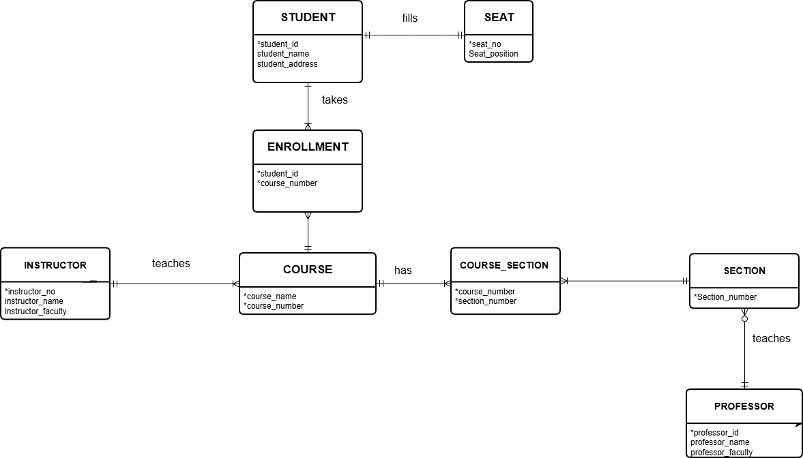

# Lab 2 - Conceptual Modeling using Draw.io
This lab will meet the following course objectives:
1. Determine appropriate entity structure for relational databases
2. Apply the correct terminology to an ER Model
3. Design an ER model

## Instructions
In this lab, you will practice writing business rules that describe the relationships between entities. Using the school ER diagram below, write and recreate a conceptual ER diagram that illustrates the relationships shown.

You will record your relationships within this README file. When writing down the relationships, follow the bullet points below.
- Entity names are uppercase and bolded
- The connecting verb is underlined
- Bidirectionality of the relationship is represented

Once you complete the README.md file, create an ER Diagram based on the relationships you identified. Create the ER Diagram using a free web-based tool called draw.io. The shapes you will use to create your ER diagram can be found under the "Entity Relation" tab. Instructions on how to use draw.io are in the assignment resources section below.

## Requirements

### Deliverable 1 (5 Points)
All relationships are identified, including the relationships that are formed when identifying the new **associative entities**

### Deliverable 2 (5 Points)
Update the ReadMe.md file to reflect the relationships. The relationships adhere to the following bullet points below.
- Entity names are uppercase and bolded
- The connecting verb is <ins>underlined</ins>
- Bi-direction of the relationship is represented

### Deliverable 3 (5 Points)
A conceptual Entity Relationship Diagram(ERD) is created to reflect all entities and relationships identified in the write-up

## Submission Guidelines
For this lab, submit 2 items to the repository. The two items that you will need to submit are listed below:
1. The README.MD file that identifies the various Entities and briefly describes each entity, including possible attributes, relationships, and assumptions.
   1. When identifying relationships, be sure to bold and uppercase the entity name, underline the verb, and make sure relationships are bidirectional.
   2. When identifying assumptions, make sure to formulate assumptions based on what is represented in the school ERD with either a Yes or No.
   3. You can override this README.md file that contains the instructions or extend this README.md file by listing your requirements below the lab Resources section.
2. The draw.io XML file that contains your ER Diagram. You will also need to take a snippet of the ER Diagram and add it as an image in your README file.

Once you complete both items above, submit the link to your repository for lab 2 before the due date and time listed.

## Lab Resources
- [Mark-down Syntax Cheat Sheet](https://enterprise.github.com/downloads/en/markdown-cheatsheet.pdf)
- [Make a ReadMe file Web-based Editor](https://www.makeareadme.com/)
- [Draw.io Web-based diagramming tool](https://app.diagrams.net/)
- [Creating Entity Relationship Diagrams using Draw.io](https://www.youtube.com/watch?v=lAtCySGDD48)

---

## Student Work Added Below

### Entity Descriptions
- **STUDENT**: Represents a student. Attributes shown are student ID, name, and address.
- **SEAT**: Represents a seat. Attributes shown are seat number and seat position.
- **ENROLLMENT**: Associative entity connecting a student and a course. Attributes shown are student ID and course number.
- **COURSE**: Represents an academic course. Attributes shown are course name and course number.
- **COURSE_SECTION**: Associative entity connecting a course and a section. Attributes shown are course number and section number.
- **SECTION**: Represents a course section. Attribute shown is section number.
- **INSTRUCTOR**: Represents an instructor. Attributes shown are instructor number, name, and faculty.
- **PROFESSOR**: Represents a professor. Attributes shown are professor ID, name, and faculty.

### Relationships
- Each **STUDENT** <ins>fills</ins> exactly one **SEAT**, and each **SEAT** <ins>is filled by</ins> exactly one **STUDENT**.
- Each **STUDENT** <ins>has</ins> one or more **ENROLLMENT** records, and each **ENROLLMENT** <ins>belongs to</ins> exactly one **STUDENT**.
- Each **COURSE** <ins>has</ins> one or more **ENROLLMENT** records, and each **ENROLLMENT** <ins>is for</ins> exactly one **COURSE**.
- Each **COURSE** <ins>has</ins> one or more **COURSE_SECTION** records, and each **COURSE_SECTION** <ins>belongs to</ins> exactly one **COURSE**.
- Each **SECTION** <ins>is associated with</ins> one or more **COURSE_SECTION** records, and each **COURSE_SECTION** <ins>identifies</ins> exactly one **SECTION**.
- Each **INSTRUCTOR** <ins>teaches</ins> one or more **COURSE** entities, and each **COURSE** <ins>is taught by</ins> exactly one **INSTRUCTOR**.
- Each **PROFESSOR** <ins>teaches</ins> zero or more **SECTION** entities, and each **SECTION** <ins>is taught by</ins> exactly one **PROFESSOR**.

The model represents a student's course-taking relationship through **ENROLLMENT**, and a course's section relationship through **COURSE_SECTION**.

### Assumptions
- Can one **STUDENT** have multiple **ENROLLMENT** records? **Yes.**
- Can one **COURSE** have multiple **ENROLLMENT** records? **Yes.**
- Can one **COURSE** be associated with multiple **COURSE_SECTION** records? **Yes.**
- Can a **PROFESSOR** teach zero **SECTION** entities? **Yes.**
- Must each **SECTION** be taught by exactly one **PROFESSOR**? **Yes.**
- Can one **INSTRUCTOR** teach multiple **COURSE** entities? **Yes.**
- Can one **ENROLLMENT** record represent multiple students? **No.**
- Can one **STUDENT** fill multiple seats? **No.**

### ERD Snippet

### Summary
The conceptual model shows how students, seats, enrollments, courses, course sections, instructors, and professors relate in a school system. **ENROLLMENT** and **COURSE_SECTION** represent the associations between their related entities.
